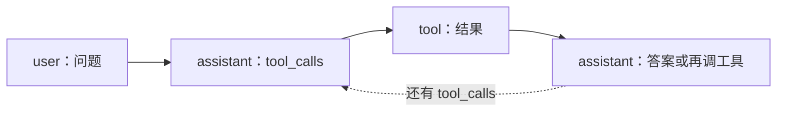
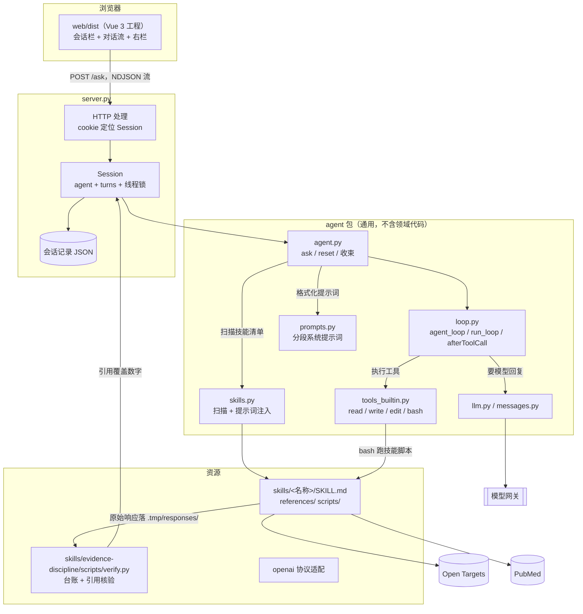
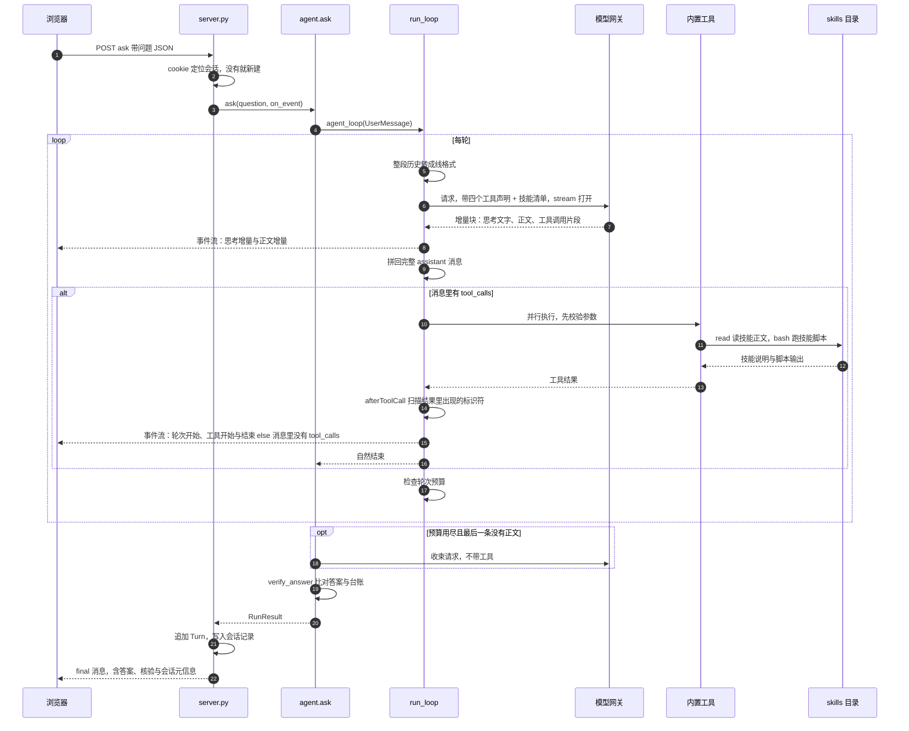
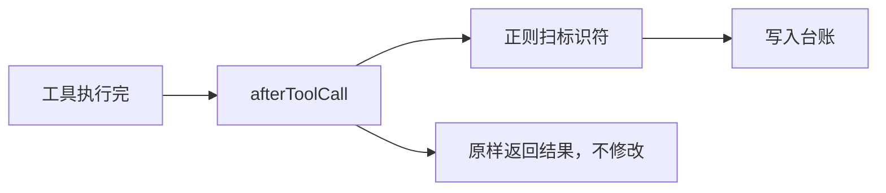
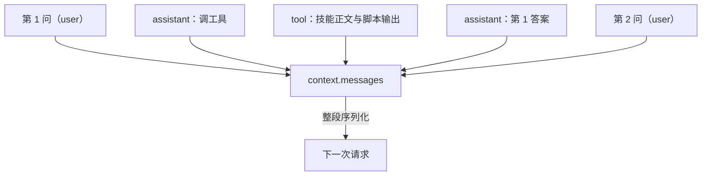

# BioEvidence Agent 原理、架构与多轮会话

这一版把领域工具删掉了：agent 手上只剩 pi 的三个内置工具，专业知识搬进 skills 目录。本文讲清一套 pi 形状的 agent 怎么跑起来。数字在 `deliverables/生物信息/report.ipynb` 对应章节可复查。

---

## 1. 原理：为什么必须是 agent loop

一次 `chat/completions` 请求的答案只能来自两处：模型权重里的记忆，或这次请求里已有的文本。生物医学问题的证据不在权重里，所以要么现场查、要么编。

工具补的就是这一步。协议上工具不是「模型调用函数」，而是四种消息的往返：

协议约束决定了循环的形状：`tool` 消息必须紧跟带 `tool_calls` 的 `assistant` 消息，顺序错了网关直接返回 400。模型给一次 tool_calls，代码必须执行完、把结果追加进消息列表，才能发下一次请求。「多轮」因此有两层：

| 层 | 含义 | 谁控制 | 出口 |
|---|---|---|---|
| 内层 | 同一个问题内的「模型 → 工具 → 模型」 | `agent/loop.py` 的 `run_loop` | 模型不再要工具，或轮次预算用尽 |
| 外层 | 用户视角的连续对话，第二问带着第一问的证据 | `agent/agent.py` 的 `ask` + 复用的 `context.messages` | 用户不再问，或新建会话 |

---

## 2. 架构：pi 的四层 + 两个目录

| 层 | 文件 | 职责 | 对应 pi |
|---|---|---|---|
| 消息层 | `messages.py` | 三种内部消息 + 转 OpenAI 线格式 | `types.ts`、`defaultConvertToLlm` |
| 工具层 | `tools_builtin.py` | `read` / `write` / `edit` / `bash`，即 pi 的 `DEFAULT_TOOL_NAMES`；含截断与全文落盘 | `dist/core/tools/{read,write,edit,bash}.js` |
| 循环层 | `loop.py` | 循环、硬停止、截断保护、并行执行、`before_tool_call` / `after_tool_call` | `agent-loop.ts` 的 `runLoop` |
| 接入层 | `llm.py` | HTTP、可重试状态码退避、SSE 逐块解析、边界解析 | `stream-fn.ts`、provider adapter |
| 提示词层 | `prompts.py` | 按段拼装系统提示词：preamble / 工具 / 规则 / 技能清单 / cwd；角色与输出格式由技能正文提供 | `dist/core/system-prompt.js` |
| 技能层 | `skills.py` | 递归发现 `SKILL.md`、按规范校验、拼 `<available_skills>` 清单 | `dist/core/skills.js` |
| 编排层 | `agent.py` | 会话状态、轮次预算、收束；不含任何领域判断 | `agent.ts` |
| 核验 | `skills/evidence-discipline/scripts/verify.py` | 扫本轮原始响应建台账，比对答案里的标识符 | 无，本项目特有 |

两个目录：

| 目录 | 内容 | 谁写 |
|---|---|---|
| `skills/` | `SKILL.md` + `references/` + `scripts/`，领域知识全在这里 | 人 |
| `.tmp/` | `responses/` 原始响应、`bash/` 超长输出全文、`sessions/` 会话记录 | 运行时 |

技能清单只把 `name` / `description` / `location` 注入系统提示词，正文与脚本不进上下文。这是 pi 的做法，也是「按需加载」的全部含义。

---

## 3. 一次提问的完整流程

以「AD 关联基因」为例：

工具的真实身份就是四个：`read` 读文件、`write` 写文件、`edit` 改一段、`bash` 跑命令。发网络请求没有专用工具，靠 `bash` 跑技能里的 `scripts/*.py`（只用标准库，任何 python3 都能跑）；搜文本靠 `bash` 里的 `grep`，不单独设工具。这是 pi 的形状——**网络访问与搜索都是命令的能力，不是工具列表里的一项**。

四个机制：

| 机制 | 代码位置 | 为什么需要 |
|---|---|---|
| 参数先校验后执行 | `loop.py` 的 `execute_one` 调 `validate_tool_arguments` | schema 不符就不执行，回一条错误结果让模型自己改 |
| 截断保护 | `run_loop` 中 `stop_reason == "length"` 分支 | 输出被长度上限切掉时 tool_calls 的 JSON 可能不完整 |
| 并行与顺序回填 | `execute_tool_calls`：`asyncio.gather`，除非工具声明 `sequential` | 一次读技能 + 发请求很常见，并行省时间 |
| 预算与收束 | `agent.py` 的 `_turn_budget` 与 `force_final_answer` | 通用工具一轮做不完一件事，预算边界上必须能收住 |

### 3.1 流式：两类增量分开走

`llm.py` 把请求里的 `stream` 打开，用 `requests` 逐行读 SSE：每一行 `data:` 解成一块，`delta.reasoning_content` 推向 `reasoning_delta`，`delta.content` 推向 `text_delta`，`delta.tool_calls` 按 `index` 攒起来。流结束时拼成一条完整的 `AssistantMessage`，后面所有代码看到的还是那条消息，与不分流时一模一样。

| 事件 | 含什么 | 前端拿它做什么 |
|---|---|---|
| `reasoning_delta` | 模型思考的一个片段 | 追进折叠块的灰字段，滚到底 |
| `text_delta` | 正文的一个片段 | 直接追进对话流，边生成边读 |
| `message_end` | 拼好的整条消息 | 不入库；正文在 `final` 里再来一份带格式的版本 |

两个边界：工具调用的参数是分片到达的，没拼完之前不执行；正文增量只是预览，答案的权威版本仍是 `final` 里的 `answer`。

### 3.2 系统提示词按段拼装

`prompts.py` 对应 pi 的 `buildSystemPrompt`：正文用 `<tools>` / `<rules>` / `<output_format>` 包段，末尾追加技能清单与 `<cwd>`。工具段与规则段不是常量，而是由「本次选了哪几个工具」推导：有 `bash` 而没 `grep` / `find` / `ls` 时，加一条「列目录、找文件都用 bash」。角色那段是本作业唯一改写的地方（pi 是编码助手，这里是生物医学研究助手）。

`GET /prompt` 把拼好的全文返回给浏览器，界面上看到的就是发给模型的原文。

### 3.3 从界面点名技能

输入框打 `/` 弹出技能菜单（名称与一句话说明，数据来自 `GET /prompt` 的 `skills`）。选定后提交的仍然是一句人话，只是开头顶了 `/技能名`，`server.py` 的 `expand_skill_prefix` 把它展开成「用技能 X（正文路径）回答下面的问题，先读该技能再动手」加原问题。落库的 `question` 保留用户原话，发给模型的是展开后的文本。

### 3.4 界面这一层的四个状态

聊天页能做的事对应四个服务端状态，界面本身不存状态：

| 界面 | 服务端 | 边界 |
|---|---|---|
| `/model` 弹窗选模型 | `POST /model` 改 `Session.model`，下一轮生效 | 不重开上下文，已发生的对话原样留着 |
| `/clear` 清上下文 | `POST /clear` 调 `agent.reset()` | 只清模型侧上下文，已落盘的问答记录不删 |
| 停止按钮与 Esc | `POST /abort` 置位 `Session.cancel` | 在轮次边界生效，不会切断已经发出的请求 |
| 右栏轨迹与文件 | `GET /sessions/<id>/turns`、`GET /files`、`GET /file` | 文件只读工作目录，越界一律 404 |

「过程可见程度」现在只有一种：聊天区只留思考块（运行中显示，完成后收起），上下文、工具、技能与 token 全部进右栏轨迹。轨迹面板读的是同一批落盘事件（`request_start` 带每条消息的角色与字数、`message_end` 带字数/token/停因、`tool_execution_end` 带参数、全文与耗时），所以刷新页面后看到的账本与运行中一致。

---

## 4. 台账：从「工具内部登记」改成「工具出口扫描」

领域工具里有 `ledger.add(...)`，删掉工具就一起没了。现在的登记点对齐 pi 的 `afterToolCall` 钩子：工具执行完、发 `tool_execution_end` 之前，把结果文本扫一遍，凡出现 `PMID` / `ENSG` / `MONDO` 就登记。

`bash` 超限时只把末尾回给模型，被截掉的头部仍算「工具输出过」，所以钩子还会读 `details.full_output_path` 把全文一起扫——否则答案引用真实出现在头部里的 PMID 会被误判未核验。

**这条设计的攻击面要说清**：台账记录的是「工具输出里出现过」，不是「数据库真的返回过」。`bash` 里 `echo ENSG00000000000` 同样会进台账，核验就会放过它。前一版把登记写在领域工具内部，模型伪造不了；这一版换来了通用性，丢掉了这层防伪。对课程作业来说这仍然是有效检查——它挡住了最常见的失败（模型凭记忆写出没人返回过的 id）——但它不是密码学意义的证明。

---

## 5. 多轮会话

### 5.1 三份状态

| 状态 | 存在哪 | 内容 | 生命周期 |
|---|---|---|---|
| 模型侧上下文 | `agent.context.messages`（内存） | user / assistant / toolResult 全量消息 | 进程存活期；`reset()` 清；不落盘 |
| 证据台账 | `agent.ledger`（内存） | 工具输出里出现过的标识符 | 同一会话内跨轮累积 |
| 问答记录 | `Session.turns` + `.tmp/sessions/<id>.json` | 问题、剪裁后的事件、答案、核验结果 | 落盘，重启可回放 |

三份状态由同一个 `Session` 持有（`server.py`），一个浏览器标签的 cookie 对应一个 `Session`，`Session` 内的锁保证同一会话不会同时跑两个循环。

### 5.2 追问时发生的事

`ask()` 的 `_build()` 只在 `context is None` 时新建，否则复用。第二问的请求是「旧历史 + 新问题」：

数字见 `deliverables/生物信息/report.ipynb` 第 6.2 节。两处容易误解的地方：

1. 轮次预算每次提问重置，`_turn_budget` 数的是本轮新增的 assistant 条数，不是全会话累计。
2. 台账不重置，核验是全会话口径：第二问引用第一问查到的 id 仍算可核验，`ledger_size` 是累计数。

### 5.3 会话的四种状态迁移

| 动作 | 服务端做什么 | 浏览器看到什么 |
|---|---|---|
| 新建 | `POST /sessions` 造空 Session，cookie 指过去，落盘空记录 | 对话清空，左栏置顶一条「新会话」 |
| 提问 | 跑循环，完成后追加 Turn 并落盘，标题为空时取问题前 40 字 | 过程块流式滚行；`final` 回带的 session 用来改标题与排序 |
| 切换 | `POST /sessions/<id>/select` 改 cookie，`GET /sessions/<id>/turns` 取记录 | 用存储的事件重放，折叠块默认收起 |
| 重启 | `load_all()` 扫会话文件恢复记录；agent 是新构造的空对象 | 列表与回放正常；旧会话能看不能接着问 |

---

## 6. 四条第不变量

1. 上下文里只有工具真的返回过的文本。模型要写标识符，只能从这些文本里抄。
2. 台账由钩子在工具出口登记，不在提示词里约定。
3. 核验是程序判定：三条正则扫答案并逐条查台账，得出 `cited / unverified / coverage`。
4. 收束保证边界行为：预算用尽且最后一条没有正文时，补一次不带工具的请求。

第 2 条比前一版弱，原因见第 4 节最后一段。

---

## 7. 代价与边界

| 代价 | 现在的情况 | 依据 |
|---|---|---|
| 轮次更多 | 一件事要「读技能 → 跑脚本 → 读结果」，8 轮预算不够，实测需要 12–14 | 报告第 6、8 节 |
| 上下文线性增长 | 每轮重发全量历史，聊得越久越贵 | 报告第 6.2 节 |
| 没有压缩 | 长会话最终会撞模型窗口 | `loop.py` 头部注释列明去掉的部分 |
| 台账可被 `bash` 伪造 | `echo` 一个 id 也能进台账 | 第 4 节末段 |
| 单数据源 | 结论正确性依赖 Open Targets 一家 | 报告局限 |
| 稳定性靠技能质量 | 技能里没写清的字段名，模型会连错两三次 | 报告第 8 节 |

模型窗口的具体上限没有实测，上表「会撞窗口」是按「全量历史重发」推的。
