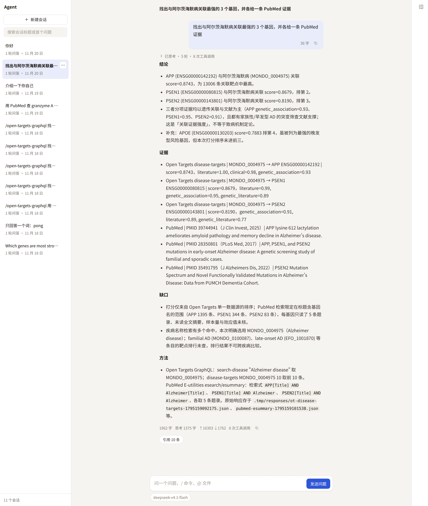
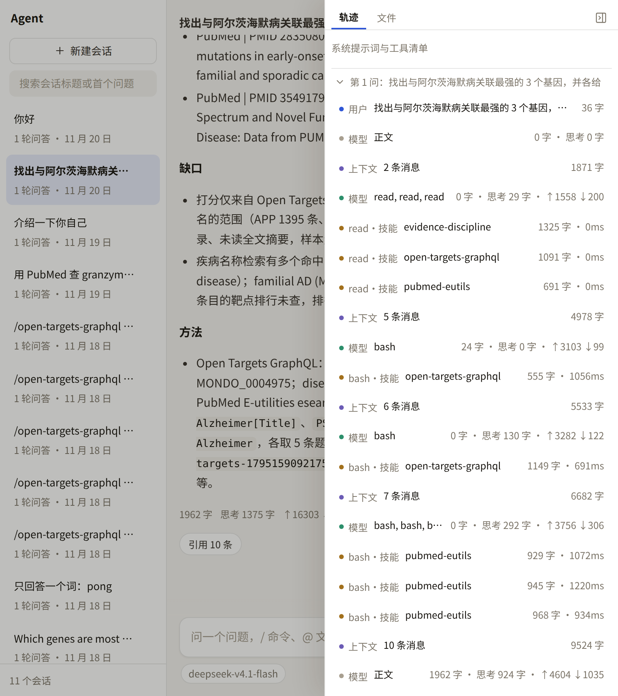
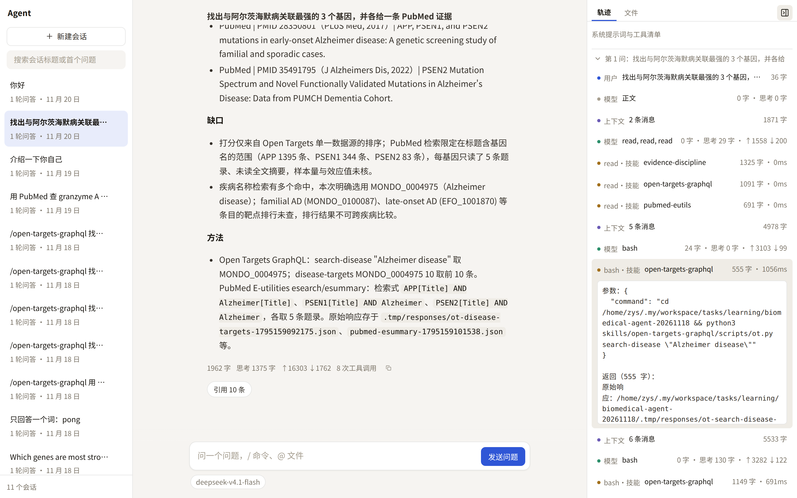

# Agent 对话界面的前端设计与实现

**摘要** 本课程作业实现了一个把通用 agent 内核与前端的对话界面分开的 Web 应用。用户提问后，浏览器用 `fetch` 读一条 NDJSON 事件流，边收边画：思考逐段追加、工具调用逐条列出、答案流式渲染，落定后换成带引用徽章的正式答案。界面用 Vue 3 + Vite，17 个单文件组件（16 个组件加一个根组件）、3 个状态模块、一份 451 行的样式刻度表，不引入 UI 组件库、状态管理库与 Markdown 库，图标取自 `lucide-vue-next`，是全项目唯一新增的依赖。这一版把界面从深色调试面板改成亮色工作台：暖灰画布、白面、单一强调蓝，三栏收成 240px / 自适应 / 380px，右栏默认收起成 56px 窄条，正文居中在 74ch 的舒适行宽上。动效按一套规范落地：五个时长、两条缓动曲线，只用透明度与不超过 6px 的位移，浮层退出比进入短，快速连续操作不排队，系统开启减弱动态时全部时长归零。前端只认七类事件，实时一轮与会话回放走同一个渲染函数；后端是一个 Python 标准库 `http.server` 服务，负责起 agent 循环并把事件逐行推给浏览器，本报告作为支撑单独一节说明。全文交代开发背景、概要设计、关键技术、使用方法与验证数据。

**关键词** Vue 3；单文件组件；NDJSON 流式渲染；CSS 变量；动效规范；响应式布局

## 1 开发背景

### 1.1 界面要解决的问题

这个应用的内核是一个能自己调工具的 agent：它读文件、跑查询脚本、拿返回的数据写答案，一次提问往往要五轮以上模型往返、近十次工具调用。命令行的输出适合事后翻看，不适合现场演示与连续追问。界面要解决三件事：

1. **看见过程**。模型正在读哪个文件、跑了哪条命令、花了多少 token，每一步都要在页面上有位置，而不是一个转圈的加载图标。
2. **看见证据**。答案下方列出本次运行真正查到的标识符，每条先给人能读的名称，再给编号与站点。
3. **可以打断**。发现方向不对时按 `Esc` 或点停止，界面立刻停住，已经产生的过程记录保留。

以本报告验证时的一次真问答为例：问题是「找出与阿尔茨海默病关联最强的 3 个基因，并各给一条 PubMed 证据」，结果 5 轮模型往返、8 次工具调用、答案 1962 字、思考 1375 字、`↑1603 ↓1762` token、引用 10 条、覆盖率 1.0。这些数字都要在界面上有对应位置，否则用户只能看到一段文字。

### 1.2 技术选型

课程允许 HTML+CSS+JavaScript 或 HTML+CSS+Vue/React，本项目选 Vue 3 + Vite，并刻意不引入几类常见依赖：

| 选择 | 理由 | 代价 |
|---|---|---|
| Vue 3 单文件组件 | 一轮问答有七八种状态（等模型、生成中、工具执行、失败、已中止、完成），状态一多，模板里就会出现层层 `v-if`；组件化后每种状态一个文件，改样式不动逻辑 | 需要一次构建，交付目录多一个 `dist/` |
| Vite | 1749 个模块构建 322ms，产物 JS 101.67 kB（gzip 39.17 kB）、CSS 22.18 kB（gzip 4.74 kB） | 引入 Node 工具链 |
| 图标集 lucide | `lucide-vue-next` 覆盖页面上的十余种图标（列表树、文件、面板、箭头、加号、更多、复制、勾），手写的 SVG 形状不统一；按需引入，只打包用到的形状 | 多一个依赖，构建模块数从 34 增到 1749（绝大多数是未被引入的图标） |
| 不引 UI 组件库 | 界面只有三栏、两种按钮、一种输入框；组件库的体积与默认样式都要再一一覆盖 | 每个控件自己写样式 |
| 不引状态管理库 | 全站只有三个状态模块，模块级 `reactive` 单例已经够用，`Pinia` 多一层安装与约定 | 状态跨模块共享时靠 import，不靠 store 注入 |
| 不引 Markdown 库 | 答案只用到标题、有序/无序列表、粗体与行内代码，32 行的 `mdToHtml` 就够 | 不支持表格、链接语法与代码高亮 |
| 动效手写 CSS | 过渡与关键帧都是「出现一次」或「开合一次」，用 CSS 变量与 Vue 的 `<Transition>` 就够，省一个动画库 | 复杂编排要自己写关键帧 |

### 1.3 前端与后端的边界

前后端只靠一套 NDJSON 事件耦合。后端每产生一个事件就往响应体写一行 JSON，结束再写一条 `final`；前端不关心循环怎么跑，只关心 `event.type`。换界面不用动后端，换后端只要事件字段不变也不用动界面。协议里的字段在 `2.5` 节列表说明。

## 2 概要设计

### 2.1 三栏与信息归属

界面横向分三栏，每样信息只有一个去处：

| 区域 | 放什么 | 不放什么 |
|---|---|---|
| 左栏（240px） | 品牌、新建会话、搜索框、会话列表（标题、轮次、相对时间） | 会话内容预览 |
| 中栏（自适应，行宽 74ch） | 提问气泡、过程折叠块、答案、引用徽章、计量行、输入框 | 上下文条数、工具参数、技能清单 |
| 右栏（展开 380px，默认收起成 56px 窄条） | 「轨迹」每问一组的账本、「文件」页签的目录树与预览 | 答案正文 |

分栏的依据是频率：过程与上下文只在想核对时看，放进右栏；答案与提问每轮都读，留在中栏。中栏行宽限制在 `74ch`（1440px 下约 615px），两侧留白对称，长答案不会横跨整个屏幕。

右栏默认收起成 56px 窄条，条上只有一个展开按钮，落在展开后收起按钮的那一格：点下去按钮原地换成相反方向的图标，位置不变。这样做的原因是居中：三栏常驻时中栏的中心会落在窗口左半边，读长答案时视线一直在偏左的位置；收起窄条后正文回到窗口中央，想看轨迹点一下即可。展开与收起都动 `flex-basis`，内容列宽不变，只整体位移。



### 2.2 组件树

17 个单文件组件，按界面层次组织，每个文件的职责单一：

| 层次 | 组件 | 负责的界面 |
|---|---|---|
| 根 | `App.vue` | 三栏骨架，挂载时拉会话列表、系统提示词，回放最后一个会话 |
| 左栏 | `SessionList` | 列表、行内改名、行右侧 `⋯` 菜单（重命名、删除）、按标题与首个问题过滤 |
| 中栏 | `Conversation` | 滚动容器，贴着底部时跟随流式内容，翻上去就不再打扰 |
| | `TurnBlock` | 一轮问答的装配：问句 + 过程块 + 流式文本 + 失败告警 + 答案 + 徽章 |
| | `Question` / `Answer` | 提问气泡与答案正文（Markdown 转 HTML）、右上角复制按钮 |
| | `ProcessBlock` / `ThinkBlock` | 过程折叠块与思考流，完成后自动收起并改标题为「已思考 · N 轮 · M 次工具调用」 |
| | `EvidenceBadge` | 「引用 N 条」徽章，展开后一行一条引用 |
| | `CopyButton` | 剪贴板与勾选状态，三处共用 |
| 右栏 | `TrajectoryRail` | 收起时的窄条与展开按钮、展开后的页签与账本、窄屏遮罩与打开按钮 |
| | `RecordCard` | 一条记录：行首归属色圆点、名字、目标、字数与耗时，点开看参数与返回全文 |
| | `PromptSheet` / `FileView` / `FileNode` | 系统提示词折叠面板、文件树与文本预览、递归的目录节点 |
| 输入区 | `Composer` | 输入框、`/` 与 `@` 菜单、发送、停止、键盘归属、跳到最新 |
| | `ModelMenu` | 底部模型座位与上下文计量 |

众数组件只有十几到三十行：`ThinkBlock` 14 行、`Question` 15 行、`RecordCard` 17 行。最大的三个是 `Composer` 225 行、`SessionList` 143 行、`TrajectoryRail` 143 行，它们各自承载一整套交互。

### 2.3 状态：一份 turns，三个模块

状态放在 `composables/` 三个文件里，每个文件导出模块级 `reactive` 单例，组件直接 import，不用 `provide/inject`：

| 模块 | 管的范围 | 行数 |
|---|---|---|
| `useStream.js` | `chat.turns`、忙碌标志、事件解析、`applyEvent()`、`replay()`、`ask()`、`abort()` | 166 |
| `useSessions.js` | 会话列表与当前会话、新建/切换/改名/删除、搜索、模型选择、清空上下文 | 68 |
| `useRail.js` | 右栏开合（默认收起）、窄屏浮动、页签、「跳到最新」标志、滚动到底 | 34 |

`chat.turns` 是全站唯一的渲染源。中栏把它铺成一轮轮问答，右栏从同一份 `turns[].events` 推导账本记录，所以「实时一轮」与「回放一轮」不需要两套代码。`useRail` 里用 `matchMedia('(max-width: 1080px)')` 建立一次媒体查询对象，监听它的 `change` 事件在「窄条展开」与「窄屏浮层」两种形态之间切换，避免在组件里反复调用 `innerWidth`。

### 2.4 一次提问的渲染时序

1. `Composer` 的 `send()` 清空输入框、关菜单，调用 `ask(text)`。
2. `ask()` 往 `chat.turns` 末尾推一个空白轮对象，字段齐全（`phase: 'running'`、`events: []`、`usage: {p:0,c:0}`），页面立刻出现提问气泡与「thinking…」的过程块。
3. `POST /ask` 的响应体是一个流。前端拿 `res.body.getReader()`，按换行切 JSON，`event` 交 `applyEvent()` 改当前轮，`final` 记下来，`failure` 直接落到失败态。
4. `applyEvent()` 按事件类型改字段：`reasoning_delta` 追加思考，`text_delta` 追加正文，`tool_execution_start` 加一次调用计数，`message_end` 累加 token。
5. 收到 `final` 时 `finish()` 收起过程块、清掉流式文本、写入正式答案与核验结果、`phase` 改成 `done`；页面重画成答案区 + 引用徽章 + 计量行。
6. 从提问到落定，浏览器始终只有一个正在进行中的 `fetch`。

### 2.5 事件、状态与重画

后端推七类事件，前端只保存这七类，其余（带整条消息的 `message_start` 等）用完即弃：

| 事件 | 改的状态 | 界面变化 |
|---|---|---|
| `turn_start` | `turn.turns++` | 过程块标题里的轮次 |
| `request_start` | `chat.ctxBase`、`chat.ctxRound` | 输入框下方「上下文 N 条 · M 字」 |
| `reasoning_delta` | `turn.reasoning` | 过程块里的思考流 |
| `text_delta` | `turn.text` | 答案区边生成边显示 |
| `message_end` | `turn.usage`、`chat.ctxRound` | 计量行里的 `↑p ↓c` |
| `tool_execution_start` / `tool_execution_end` | `turn.calls`、`turn.errors`、`turn.events` | 右栏记录、过程块下的红字 |
| `loop_stop` / `forced_final_answer` | `turn.events` | 右栏的「停止」「收束」记录 |
| `final` | 整轮结案 + 会话元数据 | 答案、徽章、左栏行时间与轮次 |

## 3 关键技术

### 3.1 流式读 NDJSON

浏览器标准的事件流解析要走 `ReadableStream`、`TextDecoder` 与一个跨块缓冲，核心就是这个循环。三个细节决定它不出错：`dec.decode(value, { stream: true })` 处理被切开的 UTF-8 多字节字符；缓冲区只在拿到换行时切一行，半截 JSON 留到下次；`res.ok` 为假时立刻失败，不去解析错误页。

```js
const reader = res.body.getReader();
const dec = new TextDecoder();
let buf = '';
for (;;) {
  const { value, done } = await reader.read();
  if (done) break;
  buf += dec.decode(value, { stream: true });
  let nl;
  while ((nl = buf.indexOf('\n')) >= 0) {
    const line = buf.slice(0, nl).trim();
    buf = buf.slice(nl + 1);
    if (!line) continue;
    const msg = JSON.parse(line);
    if (msg.type === 'event') applyEvent(turn, msg.event);
    else if (msg.type === 'final') final = msg;
    else if (msg.type === 'failure') fail(turn, msg.message);
  }
}
```

不用 WebSocket：这套交互只有「一问一答的推送」，没有双向持续通信的需要，`fetch` 加一条流就够了，断线重连与心跳也就不用写。

### 3.2 实时与回放共用一套渲染

页面刷新或切换会话时，前端请求 `/sessions/<id>/turns` 拿回整段记录，`replay()` 把它们装成与实时同一形状的轮对象：事件过一遍白名单，`turns`、`calls`、`usage` 从事件里重算，`phase` 置 `done`，过程块收起。

事件白名单只有七类（见 `2.5`）。白名单的意义不只是省流量：这次实测的 374 个事件里只有 32 个进了数组，这 32 个再去掉 `message` 字段，体积从 26.7 KB 降到 18.3 KB。会话文件本身的大小仍取决于工具返回多少，实测 1.2 KB 到 83.9 KB。

这个做法的代价是回放细节有损：思考流与工具参数都在，但如果将来要展示逐字的流式过程，就得额外存一份时间戳。当前不需要，所以没存。

### 3.3 渲染性能

流式追字是这类界面最容易卡的地方，四道约束换来的是一问一答期间不掉帧：

1. **`delta` 不进事件数组**。`applyEvent()` 对 `reasoning_delta` 与 `text_delta` 只拼字符串，不推 `events`；右栏因此不会每来一个字就重算整栏。
2. **轮对象原地修改**。`ask()` 里取回 `turn` 的引用直接改字段，`reactive` 只重画读该字段的节点，不重建数组。
3. **流式区域不加过渡**。`.stream` 与 `.think` 上没有 `transition` 与 `animation`：每个 token 都会重建文字节点，加了过渡会逐字重排。
4. **一段一段地追**。思考块在每次更新后把自身 `scrollTop` 拉到底，不再额外触发整页滚动；中栏只在「距底不足 160px」时跟随，用户往上翻就停下并浮出「跳到最新」。

### 3.4 视觉刻度：从深色调试面板到亮色工作台

改造前是深色三档（`#0b0d10` / `#14171c` / `#1d2127`），字号 12–15px，靠边框分隔区域。问题有两个：深色底上长段中文的笔画会发虚，连续读十分钟眼睛很累；字号最小的一档在 1440px 上要凑近看。这一版改成亮色工作台，层次靠「面」与留白，不靠边框：

| 类别 | 取值 | 用途 |
|---|---|---|
| 表面三档 | `#f6f4f1` / `#fff` / `#efece6` | 暖灰画布、白卡片、浅凹槽（悬停、代码、思考块） |
| 文字四档 | `#17140f` / `#35302a` / `#7d766a` / `#a49c8e` | 强调、正文、元数据、占位符 |
| 强调与语义 | `#2f56d6` 蓝，`#1f7a55` 绿，`#b83446` 红 | 主操作与焦点、成功、失败；语义色不写进文字 |
| 归属色五点 | 用户蓝、工具绿、技能黄、上下文紫、模型灰 | 只出现在右栏记录的 6px 圆点上 |
| 字号六档 | 12.5 / 13.5 / 14.5 / 15 / 16 / 18 px | 元数据、密集区、次级、正文、引导句、标题 |
| 行宽与行高 | 74ch、1.7 | 长答案的可读性；中文行高比英文需要更多余量 |
| 间距刻度 | 4 / 8 / 12 / 16 / 24 / 32 px | 全站唯一一份 |
| 圆角刻度 | 6 / 8 / 12 px | 代码块与凹槽、控件、卡片与浮层 |
| 阴影两档 | 卡片 `0 1px 2px`，浮层 `0 10px 28px` | 只有两个层级，不叠三层阴影 |

按钮只定义两档：`.btn`（白底细边）与 `.btn.primary`（强调蓝实心），尺寸相同，最小高度 34px。滚动条与选区也取调色板的值：滑块是暖灰细条，选区是强调蓝的浅底加深色字，不落回系统默认的亮蓝与亮灰。

这一版还把配色收成一个强调色：深色版里蓝、绿、黄、紫同时出现在圆点与边框上，屏幕上颜色一多，注意力就散；现在语义色只留给 6px 圆点，页面其余部分只有暖灰与一个蓝。

### 3.5 动效系统

动效按一套规范落地，而不是逐处调参数。刻度只有五个时长与两条曲线：

| 令牌 | 值 | 用途 |
|---|---|---|
| `--t-press` | 90ms | 按压反馈（缩放） |
| `--t1` | 160ms | 悬停、聚焦、颜色、答案落定 |
| `--t2` | 240ms | 普通进入：新一问、新记录、整块淡入 |
| `--t3` | 300ms | 大块切换：右栏展开、窄屏浮层 |
| `--t-out` | 140ms | 浮层退出，比进入短 20%–30% |
| `--ease-out` | `cubic-bezier(.2, .8, .2, 1)` | 进入：先快后慢 |
| `--ease-in` | `cubic-bezier(.4, 0, 1, 1)` | 退出：干脆 |

逐组件的完整规范（触发方式、进入与退出时长、缓动、位移幅度、层级、中断策略、连续操作策略、低性能降级、减弱动态策略）记在 `docs/motion.md`，这里只列落地的几类：

| 位置 | 进入 | 退出 | 位移 |
|---|---|---|---|
| 换会话、首屏 | 240ms 淡入 | 直接替换 | 无 |
| 新一问 | 240ms | 无 | 上浮 6px |
| 答案落定 | 160ms | 无 | 上浮 2px |
| 会话 `⋯` 菜单 | 160ms | 140ms | 从按钮下方 4px 落下 |
| `/` 与 `@` 菜单 | 160ms | 140ms | 从输入框上方 4px 浮起 |
| 右栏展开 / 收起 | 300ms | 240ms | `flex-basis` 56px ↔ 380px |
| 窄屏浮层 | 300ms 滑入 | 240ms 滑出 | 右侧平移，遮罩 240ms / 140ms |
| 新记录 | 240ms | 无 | 上浮 6px |
| 跳到最新 | 160ms | 140ms | 上浮 6px |
| 按钮按压 | 90ms | 同 | 缩到 0.98（图标按钮 0.92–0.94） |

四条约束把上面这些串起来：

1. **只动三类属性**：`transform`、`opacity`、颜色与背景。高度、`display`、`filter`、`backdrop-filter` 都不参与过渡。整页唯一的布局动画是右栏的 `flex-basis`。
2. **先反馈，再动画**。点击立刻改状态，动画只描述变化：复制先换勾再变绿，发送先出提问气泡再等模型，失败告警直接弹出、绝不淡入。
3. **不做队列**。状态变化用类名与 CSS 过渡，同一属性反复改只会从当前计算值继续；浮层用 Vue 的 `<Transition>` 管进出，退出动画结束才移除节点。实测连开连关菜单 6 次后节点数为 0、运行中的动画数为 0；连开连合右栏 6 次，宽度在 380 与 56 之间交替，最后停在终态。
4. **键盘与状态不被动效破坏**。焦点环即时出现、从不淡入；展开收起、选中、禁用都是状态变化，不做过渡；浮层退出期间节点仍占位但不可点，`Esc` 关菜单后焦点归还给触发它的按钮（实测焦点回到 `.more` 且 `:focus-visible` 为真）。

`prefers-reduced-motion: reduce` 下所有时长压到 0.01ms、按压缩放归零，颜色、换图标、展开收起、焦点与报错照常，只是不再有过程。低性能设备不另设开关：动效只碰合成器友好的属性，帧时间不足时浏览器跳帧，终态不受影响。

### 3.6 响应式：1080px 断点

三栏的最小舒适宽度是定出来的，不是估出来的：左栏 240px、右栏展开 380px，中栏行宽 74ch 约 615px，收起右栏后是 240 + 56 + 615 = 911px。断点因此定在 1080px，给两侧留白与滚动条留出余量：

- 宽于 1080px：三栏常驻，右栏是 56px 窄条，点图标展开到 380px。
- 窄于 1080px：右栏改成 `position: fixed` 的覆盖层，不再有窄条，左栏收窄到 216px，中栏独占剩余宽度；点右上角的面板图标滑入，点遮罩或右栏内的收起图标滑回。



两种形态共用一套 DOM：宽屏收起用 `flex-basis` 让出宽度，窄屏收起用 `translateX(100%)` 滑出屏幕，遮罩与浮出按钮用 `visibility` 的延迟过渡做到「淡出之后才不可点」。

### 3.7 交互细节

- **输入框**：`textarea` 随内容增高，上限 168px；`Enter` 发送、`Shift+Enter` 换行；中文输入法组字时的 `Enter` 不触发发送（判 `isComposing`）。
- **`/` 与 `@` 菜单**：`/` 出三条命令（`/skill`、`/clear`、`/new`），`/skill` 再列出技能清单；`@` 列出当前目录条目，点目录继续往里。菜单打开时方向键与 `Enter` 归菜单，`Tab` 补全，`Esc` 关菜单；弹窗类（模型、技能）用 `locked` 锁住，输入变化不会把它顶掉；输入框失焦后延迟 120ms 才关，避免点菜单时先被关掉。
- **停止**：`Esc` 与按钮都调 `POST /abort`；按钮与 `Esc` 只在忙碌时可用。
- **复制**：提问与答案各有常驻的复制按钮，成功后换成勾，1.2 秒复原；连点只保留一个计时器，最后一次点击之后才复位；浏览器拒绝剪贴板访问时改提示手动选中。
- **跳到最新**：挂在输入框上方正中，距输入框 8px；输入框长高时跟着上移；命中后瞬时滚到底，不做平滑滚动，免得与用户自己的滚动手感打架。
- **证据徽章**：答案下方只有一个「引用 N 条」徽章，展开后每行先给名称（PubMed 标题、基因符号、疾病名），右侧标站点，下方小字是编号与来源摘要，点名称打开对应记录。



### 3.8 可访问性与失败态

`focus-visible` 有独立的 2px 焦点环，键盘 `Tab` 走一遍每个可点元素都能看到。右栏分组标题带 `aria-expanded`，页签带 `aria-selected` 与 `role="tab"`，输入框菜单是 `role="listbox"`，整轮失败用 `role="alert"` 的红色告警条报出原始错误。答案区加了 `overflow-wrap: anywhere`，长路径与长标识符（如 `skills/open-targets-graphql`）不会再撑出横向滚动。减弱动态只在系统层面响应，页面上不另设开关。

### 3.9 后端支撑

后端是 `server.py` 加 agent 包，不引框架，一个 `BaseHTTPRequestHandler` 子类写完全部路由：

| 类型 | 路由 | 说明 |
|---|---|---|
| 静态 | `/`、`/assets/*` | 发 `web/dist` 里的 `index.html` 与构建产物，越界与缺失一律 404；`index.html` 带 `Cache-Control: no-store` |
| 元数据 | `/prompt` | 系统提示词、工具清单、技能清单、模型清单 |
| 会话 | `GET /sessions`、`POST /sessions`、`/sessions/<id>/select`、`/rename`、`/delete`、`/turns` | 每个会话一个 JSON 文件，落盘在 `.tmp/sessions/` |
| 对话 | `POST /ask`、`/abort`、`/model`、`/clear` | `/ask` 返回 NDJSON 流 |
| 文件 | `/files`、`/file` | 只允许工作目录以内，跳过 `.git`、`node_modules`、`__pycache__`，单文件上限 200KB |

一个会话一个 `Session` 对象，带自己的线程锁与取消标志。`/ask` 起后台线程跑 agent 循环，事件进队列，请求线程从队列取出逐行写响应；这样长任务不会卡住其他请求，取消也只是一个 `threading.Event`。会话用 cookie 里的 id 区分，落盘记录与回放都靠它。

## 4 使用方法

### 4.1 构建与启动

```bash
cd tasks/learning/biomedical-agent-20261118
(cd web && npm install && npm run build)   # 改过前端源码要先构建
./run_server.sh                            # http://localhost:8765
```

服务端从 `web/dist` 取页面与静态资源，构建一次即生效。开发时可以 `cd web && npm run dev` 起 Vite 的开发服务器，但接口要另外指到 8765。

### 4.2 界面分区

| 区域 | 能做什么 |
|---|---|
| 左栏 | 新建会话、按标题与首个问题过滤、切换、重命名、删除 |
| 中栏 | 提问与答案；过程块显示轮次、思考流与工具调用行；答案下方是计量行与引用徽章 |
| 右栏「轨迹」 | 按问分组的账本，每条可展开看参数与返回全文；顶部是系统提示词与工具清单 |
| 右栏「文件」 | 工作目录文件树与文本预览 |
| 输入框 | 提问、`/` 命令、`@` 文件引用、停止；下方是模型座位与上下文计量 |

### 4.3 演示流程

八分钟内按这条线走：

1. 空态：说明三栏各自的职责（右栏先收起），点窄条上的图标展开，展开右栏顶部的「系统提示词与工具清单」，给听众看工具与技能。
2. 提一个问题，展示提问气泡先出现、过程块逐段追加思考、工具行逐条落进右栏。
3. 答案落定，指出过程块自动收起并变成「已思考 · 5 轮 · 8 次工具调用」。
4. 点开引用徽章，指一个 PMID 说明它来自本次运行。
5. 展开右栏一条工具记录，展示脚本参数与原始返回。
6. 追问一句，展示上下文计量与第二轮的记录组。
7. 演示中止：发一个长问题，点停止，指出过程记录保留。
8. 刷新页面回放整段对话，说明记录落盘、右栏回到默认的收起状态。

## 5 测试与验证

### 5.1 界面走查清单

界面验收用一份 44 步的走查清单（`docs/ui-checklist.md`），在 1440×900 与 800×900 两档尺寸下人工过一遍，每步写明操作、页面位置与预期结果。清单分八节：首屏与空态、提问与计量、右栏轨迹、失败与中止、菜单与命令、长历史与窄屏、排版与可读性、动效。

### 5.2 自动化行为自测

用浏览器自动化（Playwright + Chromium headless）跑过这些路径并留档：页面加载与旧会话回放、种子数据渲染出 21 条轨迹记录、记录展开与分组收起、徽章展开（引用 10 条）、模型座位清单、`/` 命令三条、`@` 文件列表、文件树展开与预览、切换会话、新建会话的空态、复制按钮反馈与剪贴板内容、真实问答的流式渲染、窄屏覆盖层与遮罩、长历史「跳到最新」、`/assets/*` 返回 200 与 `..` 越界 404。

动效与性能另跑一组，判据写进 `docs/motion.md` 第 10 节：浮层进入与退出的类名与时长、`Esc` 后焦点归还、连开连关 6 次的残留与排队、按压时的 `transform`、减弱动态下的时长、窄屏形态、以及连开合右栏 6 次期间的 `longtask`。

### 5.3 实测数据

| 项 | 结果 |
|---|---|
| 构建 | 1749 个模块，322ms；JS 101.67 kB（gzip 39.17 kB），CSS 22.18 kB（gzip 4.74 kB） |
| 源码规模 | 1676 行：16 个组件 861 行、3 个状态模块 268 行、2 个工具函数 58 行、样式 451 行、根组件与入口 38 行 |
| 布局 | 1440×900：左栏 240px、正文列 615px 居中、右栏窄条 56px、展开后 380px |
| 窄屏 | 800×900：右栏改覆盖层并带遮罩，左栏 216px，无横向滚动条 |
| 动效时长 | 菜单进 0.16s / 出 0.14s；右栏进 0.30s / 出 0.24s；按压 0.09s |
| 快速连续操作 | 菜单连开连关 6 次：残留 0 个节点、运行中动画 0 个；右栏连开连合 6 次：宽度 380 / 56 交替，终态正确 |
| 按压反馈 | 主按钮按住时 `transform` 为 `scale(0.98)`，时长 0.09s |
| 减少动态 | `reducedMotion: 'reduce'` 下过渡与动画时长均为 `1e-05s`，无报错 |
| 长任务 | 回放 21 条记录、连开合右栏 6 次期间，`longtask` 观测为空 |
| 静态资源越界 | `GET /assets/..%2f..%2fserver.py` 返回 404 |
| 中止 | 点击到落定 0.8–2.4 秒，差别在是否正在等一次模型响应 |
| 一次真问答 | 5 轮、8 次工具调用、答案 1962 字、思考 1375 字、`↑1603 ↓1762`、引用 10 条、覆盖率 1.0 |
| 会话记录 | 每个会话一个 JSON，实测 1.2 KB 到 83.9 KB，取决于工具返回的体积 |

## 6 局限与改进

1. **无认证与多用户隔离**。会话用 cookie 里的 id 区分，服务只监听本机演示端口，没有登录与权限校验。公开部署前必须补身份校验与服务端归属检查。
2. **长历史没有虚拟滚动**。`Conversation` 一次渲染全部轮次，十几问之内没有可感延迟；上百回合需要改成按可视区渲染。
3. **Markdown 只支持子集**。`mdToHtml` 认标题、列表、粗体与行内代码，遇到表格、链接语法与代码块会当普通段落。要完整渲染得换库或补解析。
4. **样式集中在一个文件**。`base.css` 451 行管全站，好处是刻度只有一份，代价是组件的作用域样式没有拆分，改一处要在 451 行里定位。
5. **没有运行时的性能探测**。动效没有做「检测掉帧就降级」的自动开关，靠「只碰合成器友好的属性 + 一处布局动画」保底，降级交给系统的减弱动态设置。真要做，得先有一个低成本的帧时间采样办法。
6. **只测了一种浏览器**。走查与自动化都在 Chromium 内核上，`::selection`、滚动条与 `details` 的细节在 Firefox、Safari 上未逐一核对。
7. **回放不含模型上下文**。落盘的只有问答记录，刷新后旧会话可看不可问；这是后端的取舍，但界面因此要处理「有记录、无上下文」的组合。

## 7 参考资料

1. Vue 3 官方文档：组件、`<Transition>`（`vuejs.org/guide`）。
2. Vite 官方文档（`vite.dev`）。
3. MDN：`ReadableStream`、`TextDecoder`、`fetch` 响应体（`developer.mozilla.org`）。
4. NDJSON 格式说明（`github.com/ndjson/ndjson-spec`）。
5. WCAG 2.2：焦点可见、减少动效（`prefers-reduced-motion`）。
6. Lucide 图标（`lucide.dev`），Vue 包 `lucide-vue-next`。
7. Python 标准库 `http.server` 与 `BaseHTTPRequestHandler`（`docs.python.org`）。
